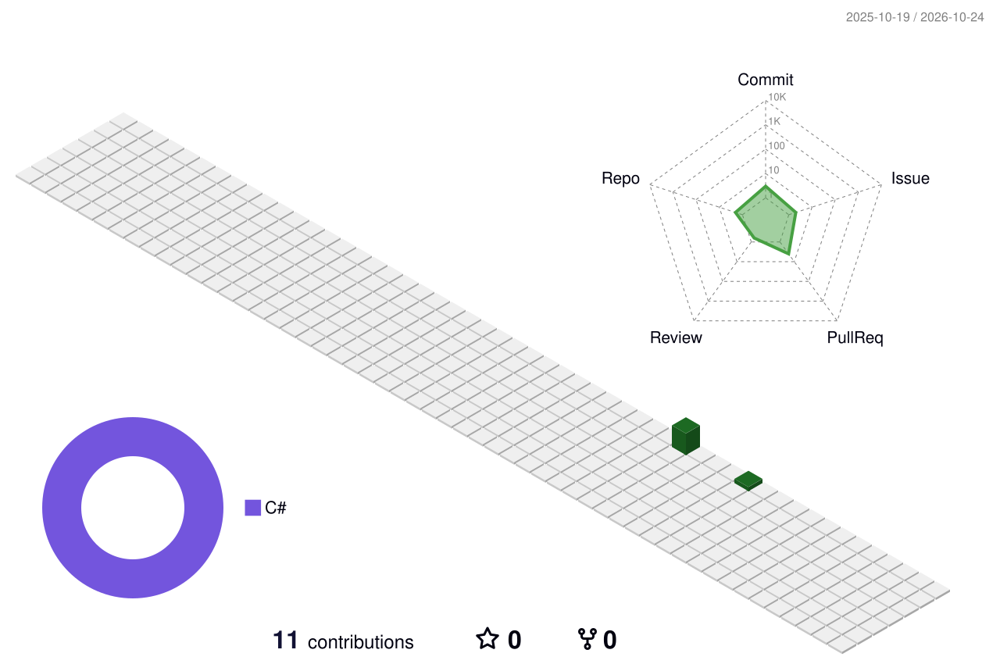

<div align="center">

<sub>🖖 **CAPTAIN'S LOG** · STARDATE 2007.06 → ∞</sub>

# Carlo Arduini <sub>aka **Mordas**</sub>


<a href="https://www.linkedin.com/in/arduinicarlo/"></a>
<a href="https://www.arduinilive.com/"></a>
<a href="https://www.arduinilive.com/Resume/"></a>

</div>

---

### 🪪 Personnel File

```csharp
// Mordas.cs — Starfleet personnel record
public sealed record Officer(string Name, string Callsign)
{
    public string   Rank           => "Backend Engineer · C# / .NET";
    public int      InServiceSince => 2007;
    public string[] Specialties    => ["C#", ".NET", "SQL Server · T-SQL", "Microservices"];
    public string   FirstOfficer   => "Claude Code";   // AI pair-programmer, daily driver
    public string[] InTraining     => ["Java · Spring Boot", "WebFlux · Project Reactor"];
    public string   CurrentMission => "Exploring strange new reactive worlds";
    public string   PrimeDirective => "Ship clean, observable, resilient backends.";
    public string   OffDuty        => "Star Trek, Star Wars & all things nerd";
}

var mordas = new Officer("Carlo Arduini", Callsign: "Mordas");
```

### 🛸 Ship's Systems

**⚡ Warp Core** — *primary systems, fully operational*


**🤖 First Officer** — *AI-assisted engineering, on the bridge every day*


**🗄️ Computer Core** — *data storage & retrieval*


**🎓 Starfleet Academy** — *currently in training*


**🖥️ Bridge Console & Engineering**


### 🔭 Long-Range Sensors

<div align="center">

<picture>
  <source media="(prefers-color-scheme: dark)" srcset="profile-3d-contrib/profile-night-view.svg" />
  
</picture>

<sub>Contribution activity, as seen from orbit · refreshed daily</sub>

</div>

---

<div align="center">
<sub>🖖 Live long and prosper · ⚔️ May the Force be with you</sub><br/>
<sub><i>— End of log. —</i></sub>
</div>
